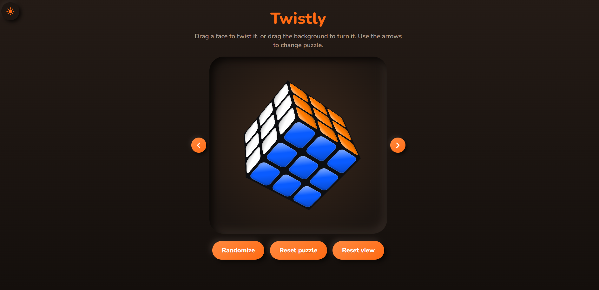

  <div align="center">

# 🧩 Twistly

### Twist. Solve. Explore.

**Your interactive twisty-puzzle playground, right in your browser.**

Experience 3D puzzles, rotate the view, twist faces, scramble puzzles, and explore — all without installing anything.

<br>

<a href="https://abhi-y-diord.github.io/Twistly/">
  
</a>
<a href="https://github.com/abhi-y-diord/Twistly">
  
</a>

<br><br>



**[🌐 Visit Twistly Live](https://abhi-y-diord.github.io/Twistly/)**

</div>

---

## ✨ About Twistly

**Twistly** is a browser-based twisty-puzzle application built with HTML, CSS, and JavaScript. It brings interactive 3D puzzles to your screen, allowing you to explore puzzles, manipulate their faces, change viewing angles, and scramble them whenever you want a new challenge.

The goal is simple: make interacting with twisty puzzles accessible, convenient, and enjoyable through a clean web experience.

No installation. No complicated setup. Just open the website and start twisting.

## 🎮 Features

- **Interactive 3D Puzzles** — Explore and manipulate twisty puzzles directly in your browser.
- **Multiple Puzzles** — Switch between the available Pyraminx, 3×3 cube, and 2×2 cube.
- **Intuitive Controls** — Drag puzzle faces to twist them and drag the surrounding area to rotate the view.
- **Random Scramble** — Mix up the active puzzle and try a new configuration.
- **Puzzle Reset** — Return the active puzzle to its starting state.
- **View Reset** — Restore the default viewing angle.
- **Light and Dark Themes** — Choose the appearance you prefer.
- **Browser-Based Experience** — No application installation required.
- **Free to Access** — Play directly from the hosted website.

## 🚀 Try Twistly

Ready to explore?

<div align="center">

### Your next twist is one click away.

<a href="https://abhi-y-diord.github.io/Twistly/">
  
</a>

</div>

### How to use

1. Open the [Twistly website](https://abhi-y-diord.github.io/Twistly/).
2. Use the navigation arrows to select a puzzle.
3. Drag the puzzle faces to interact with them.
4. Drag the surrounding area to change the viewing angle.
5. Use the scramble and reset controls to experiment with different configurations.
6. Switch between light and dark themes to suit your preference.

## 🛠️ Built With

| Technology | Purpose |
|---|---|
| HTML5 | Application structure |
| CSS3 | Styling, layout, and visual presentation |
| JavaScript | Interactions and puzzle behavior |
| GitHub Pages | Hosting and deployment |

Twistly is a static web application, so it does not require a backend server to be hosted.

## 💻 Run Locally

Want to explore the code or customize Twistly?

### 1. Clone the repository

```bash
git clone https://github.com/abhi-y-diord/Twistly.git
```

### 2. Open the project folder

```bash
cd Twistly
```

### 3. Launch the application

Open `index.html` in a modern web browser.

That's it! No package installation or build process is required for the basic static setup.

## 📂 Project Structure

```text
Twistly/
├── index.html       # Main web application
├── screenshot.png   # Application screenshot
└── README.md        # Project documentation
```

## 🌍 Live Deployment

Twistly is deployed using **GitHub Pages**, making the application accessible through a public URL.

- **Live Website:** [abhi-y-diord.github.io/Twistly](https://abhi-y-diord.github.io/Twistly/)
- **Source Code:** [github.com/abhi-y-diord/Twistly](https://github.com/abhi-y-diord/Twistly)

### Updating the website

To publish changes:

1. Update the project files in your repository.
2. Commit the changes to the `main` branch.
3. Wait for GitHub Pages to publish the latest version.

Your website will update automatically after a successful deployment.

## 🤝 Feedback and Contributions

Have an idea to improve Twistly or found something that needs fixing?

You're welcome to open an issue in the [GitHub repository](https://github.com/abhi-y-diord/Twistly) to share feedback, report bugs, or suggest improvements.

## 📄 License

No license has been specified yet. Until a license is added, don't assume others have permission to reuse, modify, or redistribute the source code.

---

<div align="center">

### 🧩 Twistly

**Twist it. Turn it. Explore it.**

Built with curiosity and a love for puzzles.

<br>

[**🚀 Launch App**](https://abhi-y-diord.github.io/Twistly/) · [GitHub Repository](https://github.com/abhi-y-diord/Twistly)

</div>
